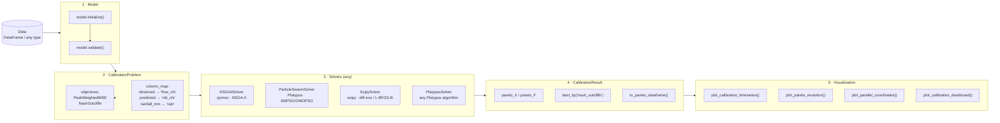
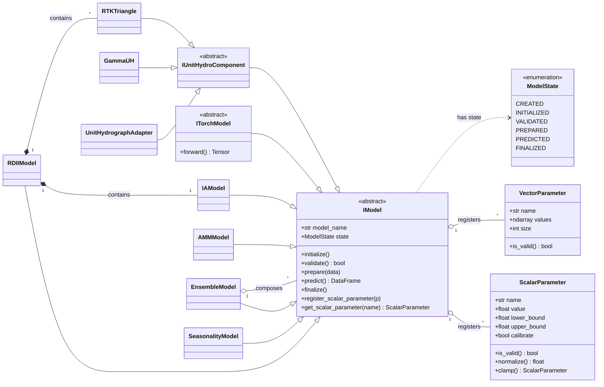
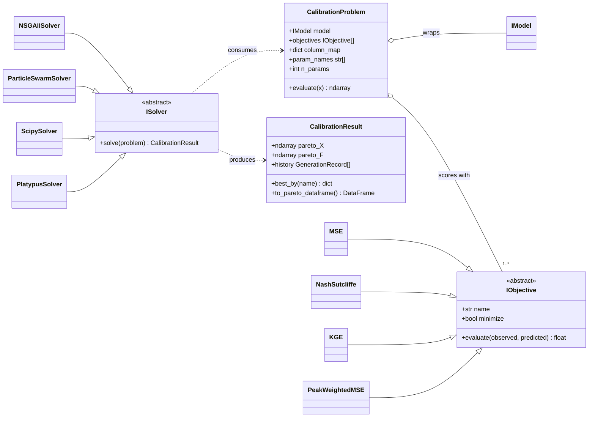
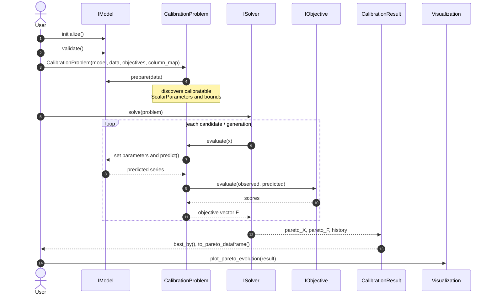

# sparsehydro

**sparsehydro** provides abstract interfaces and utilities for building *parsimonious*
(sparse-parameter) hydrological models in Python, with a focus on stormwater systems.

[](https://github.com/CoC-MSD/sparsehydro/actions/workflows/tests.yml)
[](https://coc-msd.github.io/SparseHydro/)
[](https://pypi.org/project/sparsehydro/)
[](https://pypi.org/project/sparsehydro/)
[](LICENSE)

## Package workflow



## Object relationships

Every model subclasses the abstract `IModel` lifecycle and exposes named
`ScalarParameter` / `VectorParameter` objects through a built-in registry.
Calibration tooling discovers those parameters automatically, so the same
objects flow unchanged from model construction through to visualization.



The calibration layer is solver-agnostic: a single `CalibrationProblem` wraps a
model, its data, and one or more `IObjective` functions, then passes unchanged
to any `ISolver`, which returns a `CalibrationResult`.



## Calibration workflow

The typical end-to-end calibration loop — build the model, wrap it in a problem,
solve, then inspect and visualize the results:



## Features

- **Model lifecycle** — enforced six-state progression:
  `CREATED → INITIALIZED → VALIDATED → PREPARED → PREDICTED → FINALIZED`
- **Parameter registry** — named scalar and vector parameters with lower/upper bounds,
  `calibrate` flag to freeze individual parameters, normalization, and clamping
- **Flexible calibration** — `CalibrationProblem` accepts any data type via a unified
  `column_map` dict; observed targets and predicted outputs are mapped by name or callable
- **Solver-agnostic** — the same `CalibrationProblem` passes unchanged to NSGA-II (pymoo),
  PSO (Platypus SMPSO/OMOPSO), SciPy, or any custom `ISolver`
- **PyTorch support** — `ITorchModel` combines the lifecycle interface with `nn.Module`
  for gradient-based calibration
- **pandas outputs** — `predict()` returns `pd.DataFrame | pd.Series`
- **Interactive dashboards** — Plotly-based plots for Pareto evolution, parallel
  coordinates, calibration time-series with IQR bands, and multi-panel dashboards

## Package layout

| Package | Contents |
|---|---|
| `sparsehydro` | Core: `IModel`, `ScalarParameter`, `registry`, `ModelState` |
| `sparsehydro.metrics` | Metric functions (`nash_sutcliffe`, `kge`, `pbias`, ...) and calibration objectives |
| `sparsehydro.filters` | Savitzky-Golay smoothing, dry-weather patterns |
| `sparsehydro.data` | File IO, data assembly, data service clients |
| `sparsehydro.events` | Event detection, screening and records |
| `sparsehydro.models` | Components (unit hydrographs, RDII, abstraction, snow, baseflow), `CompositeModel`, presets |
| `sparsehydro.calibration` | `CalibrationProblem`, solvers, splits, Pareto selection, sequential fitting |
| `sparsehydro.configuration` | Build models, objectives and solvers from a dict or JSON/YAML file |
| `sparsehydro.visualization` | Interactive Plotly figures |
| `sparsehydro.studies` | Study-specific workflows (for example `studies.msdgc`) |

Each package imports only from the ones above it in this table; see
[CONTRIBUTING.md](CONTRIBUTING.md#7-where-code-goes).

## Installation

```bash
pip install sparsehydro
```

Optional extras:

| Extra      | Command                               | Enables                                              |
| ---------- | ------------------------------------- | ---------------------------------------------------- |
| `speed`    | `pip install "sparsehydro[speed]"`    | Numba-compiled store kernels (much faster calibration) |
| `parallel` | `pip install "sparsehydro[parallel]"` | Parallel CMA-ES seeds via joblib                     |
| `excel`    | `pip install "sparsehydro[excel]"`    | Reading `.xlsx` event files                          |
| `viewer`   | `pip install "sparsehydro[viewer]"`   | `sparsehydro-viewer` Streamlit app                   |
| `notebook` | `pip install "sparsehydro[notebook]"` | Running your own Jupyter notebooks (ipykernel, numba, openpyxl, kaleido) |
| `docs`     | `pip install "sparsehydro[docs]"`     | Sphinx documentation build                           |
| `dev`      | `pip install -e ".[dev]"`             | Everything needed to run the tests and build the docs |

A small sample dataset ships with the package:

```python
from sparsehydro.sample_data import load_sample
df = load_sample("tc-nb-001")   # 5-min rain [in] and stormflow [cfs], March 2022
```

## Quick start — custom model

```python
import pandas as pd
from sparsehydro import IModel, ModelState, ScalarParameter

class LinearReservoir(IModel):
    model_name = "linear-reservoir"

    def initialize(self) -> None:
        self.register_scalar_parameter(
            ScalarParameter("k", value=0.3, lower_bound=0.0, upper_bound=1.0,
                            units="1/day", description="Recession coefficient")
        )
        self._state = ModelState.INITIALIZED

    def validate(self) -> bool:
        ok = self.parameters_valid()
        if ok:
            self._state = ModelState.VALIDATED
        return ok

    def prepare(self, forcing: pd.Series) -> None:
        self._forcing = forcing
        self._state = ModelState.PREPARED

    def predict(self) -> pd.Series:
        k = self.get_scalar_parameter("k").value
        self._state = ModelState.PREDICTED
        return self._forcing * k

    def finalize(self) -> None:
        self._state = ModelState.FINALIZED


model = LinearReservoir()
model.initialize()
model.validate()
model.prepare(pd.Series([10.0, 8.0, 6.0], name="P_mm"))
print(model.predict())
model.finalize()
```

## Quick start — RDII calibration

```python
import pandas as pd
from sparsehydro.models.rdii import RDIIModel
from sparsehydro.calibration import (
    CalibrationProblem,
    ParticleSwarmSolver,
    PeakWeightedMSE,
    NashSutcliffe,
)
from sparsehydro.visualization import (
    plot_calibration_timeseries,
    plot_pareto_evolution,
)

# 1. Load data (datetime, rainfall_mm, flow_cfs, temperature_c)
df = pd.read_csv("events.csv", parse_dates=["datetime"])

# 2. Create and validate model
model = RDIIModel(n_triangles=3)
model.initialize()
model.validate()

# 3. Define the calibration problem via column_map
problem = CalibrationProblem(
    model=model,
    data=df,
    objectives=[PeakWeightedMSE(), NashSutcliffe()],
    column_map={
        "observed":  "flow_cfs",    # target column in data
        "predicted": "rdii_cfs",    # output column from model.predict()
    },
)

# 4. Run PSO calibration (runtime kwargs override constructor defaults)
solver = ParticleSwarmSolver(swarm_size=50, n_evaluations=5_000, seed=42)
result = solver.solve(problem)          # full run
# result = solver.solve(problem, n_evaluations=200)  # quick test override

# 5. Inspect and visualize
best_x = result.best_by("nash_sutcliffe")
print(result.to_pareto_dataframe())

fig = plot_pareto_evolution(result)
fig.show()
```

## Unit hydrographs

Sixteen registered unit hydrographs share one convention: time parameters in
hours and kernels that do not depend on the model time step. They include Nash
cascade, gamma, SCS/NRCS, Snyder, Clark, ModClark, Weibull, lognormal,
generalized gamma, mixtures, and the RTK triangle. Any of them can route
rainfall excess in `RDIIModel`:

```python
from sparsehydro.models.rdii import RDIIModel, RTKTriangle
from sparsehydro.models.unithydrograph import ClarkUH, NashUH

model = RDIIModel(uh_components=[RTKTriangle(R=0.03, T=1.0, K=2.0), NashUH(n=3, K=2.0), ClarkUH(Tc=6, Rs=12)])
```

See [docs/unit_hydrographs.md](docs/unit_hydrographs.md) for the equations, the
full table and how to add a formulation.

## Documentation

Full documentation is available at [coc-msd.github.io/SparseHydro](https://coc-msd.github.io/SparseHydro/).

## Contributing

Contributions are welcome, including new model formulations. Please read
[CONTRIBUTING.md](CONTRIBUTING.md) before opening a pull request; it covers the
development setup, how to add a formulation, testing, and repository rules
(no notebooks, generated outputs, or large files in the repository).

This project follows the [Contributor Covenant Code of Conduct](CODE_OF_CONDUCT.md).

## License

MIT — see [LICENSE](LICENSE).
